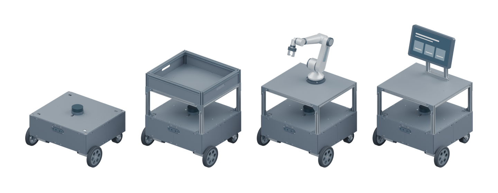
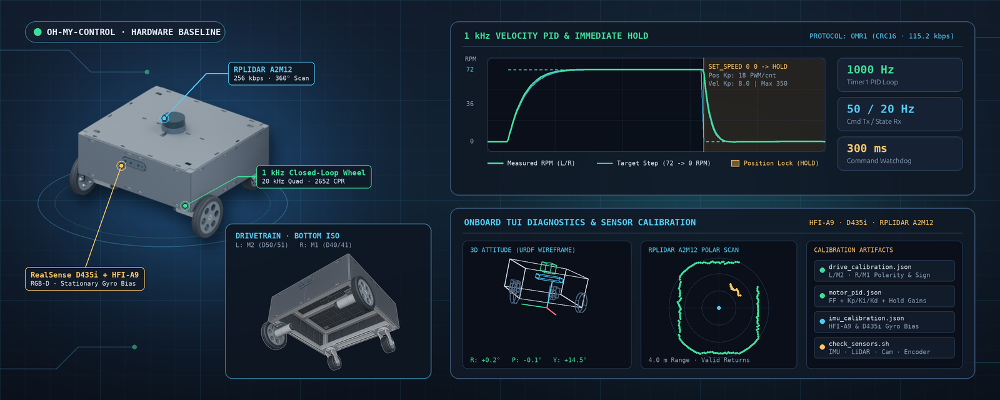

# LEE HYUN BIN

[GitHub](https://github.com/Leehyunbin0131) ·
[Email](mailto:leehyunbin0131@gmail.com)

## About Me

<table>
  <tr>
    <td align="center" valign="top">
      <picture>
        <source media="(max-width: 600px)" srcset="assets/profile.jpg" width="110">
        
      </picture>
    </td>
    <td valign="top">
      
<strong>자율주행 · SLAM · 서비스 로봇</strong>

      

        
        
        
      

      
<strong>학력</strong> 대구대학교 컴퓨터소프트웨어전공 재학

      
<strong>활동</strong> 42경산 4기 전자전기공학부 AIS 동아리 회장

    </td>
  </tr>
</table>

### 수상 이력

<table>
  <thead>
    <tr><th scope="col">연도</th><th scope="col">수상</th><th scope="col">대회 · 분야</th></tr>
  </thead>
  <tbody>
    <tr>
      <td><strong>2021</strong></td><td nowrap>🥉 동메달</td>
      <td><strong>전국기능경기대회</strong> · 모바일로보틱스</td>
    </tr>
    <tr>
      <td><strong>2021</strong></td><td nowrap>🥇 금메달</td>
      <td><strong>대구기능경기대회</strong> · 모바일로보틱스</td>
    </tr>
    <tr>
      <td><strong>2020</strong></td><td nowrap>🥈 은메달</td>
      <td><strong>대구기능경기대회</strong> · 모바일로보틱스</td>
    </tr>
    <tr>
      <td><strong>2019</strong></td><td nowrap>🥉 동상</td>
      <td><strong>IRC 국제로봇콘테스트</strong> · 자율형보행</td>
    </tr>
  </tbody>
</table>

---

## Projects

### Oh-My-MobileRobot

  
  
  
  
  
  

2020 프로파일 기반 모바일 로봇 베이스를 직접 설계·제작하고, CAD 원본에서 ROS 1·ROS 2 시각화 메시와 URDF/Xacro 모델을 생성·검증하는 파이프라인을 구축한 프로젝트입니다.

- **기간:** 2026.10 ~ 2026.11
- **개발:** 개인 프로젝트
- **현재 상태:** 기본 베이스 실물 제작·주행 확인, 확장형 3종 CAD·출력용 STL·1:1 도면 및 ROS 모델 공개
- **저장소:** [GitHub](https://github.com/Leehyunbin0131/Oh-My-MobileRobot) ([실물 사진 · 주행 영상](https://github.com/Leehyunbin0131/Oh-My-MobileRobot#completed-robot))

프로젝트 자세히 보기

#### 배경 및 목표

하나의 모바일 로봇 베이스를 바탕으로 부품 배치와 상부 모듈을 용도에 맞게 바꿀 수 있도록 설계했습니다.
기구 설계 파일과 3D 프린팅 출력 부품, ROS 모델을 함께 정리해 실제 하드웨어 치수와 소프트웨어 좌표계를 일관되게 연결하고자 했습니다.

#### 핵심 설계 및 구현

- **기구 설계 및 실물 제작:** 2020 알루미늄 프로파일로 외곽 440 × 400 × 140 mm 프레임을 구성하고, 구동 바퀴 2개와 후방 캐스터 2개, 4분할 상판·측면 커버·센서 고정부·2층 전장판을 설계해 기본 베이스 실물을 제작했습니다. 기본 베이스 위에 적재함·6축 로봇암·안내 디스플레이를 올린 공통 3층 플랫폼 확장 개념 모델 3종도 함께 구성했습니다.
- **ROS 모델 자동 변환:** 기본 베이스와 확장형 3종이 공통 Xacro와 메시를 공유하도록 구성하고, 구동 바퀴·캐스터의 회전 관절과 라이다·카메라 좌표계 및 ROS 1·ROS 2용 RViz 실행 설정을 정의했습니다. Python으로 CAD에서 시각화 메시와 URDF를 자동 생성하는 변환 도구를 작성했습니다.

#### 검증 및 결과

원본 CAD 파일 해시 일치 여부, 메시 무결성, 링크·관절 트리, 접지 높이, 센서 축 방향을 자동으로 확인하는 단위 테스트를 작성해 모델 정합성을 검증했습니다.
기구 설계부터 출력용 STL·1:1 도면, ROS 모델과 한·영 문서까지 하나의 저장소로 공개했으며, 제어·센서 연동과 동역학 시뮬레이션 설정은 사용하는 하드웨어에 맞춰 확장할 수 있는 구조로 완성했습니다.

---

### Oh-My-Control

  
  
  
  

`Oh-My-MobileRobot`에서 제작한 모바일 로봇 하드웨어에 1 kHz 모터 속도·위치 유지 제어 펌웨어와 구동·IMU 캘리브레이션 및 터미널 통합 진단 도구를 구축한 제어 베이스라인 프로젝트입니다.

- **기간:** 2026.10 ~ 2026.11
- **개발:** 개인 프로젝트
- **현재 상태:** Mega 1 kHz 속도 PID·위치 유지(`HOLD`) 제어 펌웨어, 구동·IMU 보정 파이프라인, 센서·구동 통합 진단 대시보드(TUI) 구현 및 실기 검증 완료
- **저장소:** [GitHub](https://github.com/Leehyunbin0131/Oh-My-Control) ([실물 사진 · 주행 영상](https://github.com/Leehyunbin0131/Oh-My-Control#completed-robot))

프로젝트 자세히 보기

#### 배경 및 목표

`Oh-My-MobileRobot`에서 설계·제작한 하드웨어 플랫폼에 상위 ROS 2 자율주행 스택을 연결하기에 앞서, 모터·엔코더·IMU·라이다·깊이 카메라가 물리적 제어 명령과 좌표계 기준대로 정확히 동작하는지 독립적으로 검증하고 보정하는 계층이 필요했습니다.
상위 프레임워크 없이도 하드웨어 단독으로 구동 제어와 센서 상태를 즉시 점검·재보정할 수 있는 제어 펌웨어와 진단·캘리브레이션 도구를 구축하는 것을 목표로 했습니다.

#### 핵심 설계 및 구현

- **1 kHz 모터 제어 펌웨어 및 시리얼 프로토콜(`OMR1`):** Arduino Mega 2560의 Timer1 인터럽트(1 kHz)와 20 kHz 구적 엔코더 샘플링을 기반으로 바퀴별·방향별 속도 PID 제어기와 정지 위치 유지(`HOLD`, 직접 위치 비례항 + 유지 전용 속도 피드백)를 구현했습니다. CRC16, 시퀀스 번호, 300 ms 명령 유효기간(Lease) 및 과속·포화·엔코더 오류 감시를 포함한 프레임 프로토콜로 통신 안정성을 확보했습니다.
- **구동·PID 오토튠 및 정지 자이로 보정 파이프라인:** 좌우 바퀴 채널과 전진·엔코더 부호를 판별하는 구동 방향 보정 도구, 계단 응답 기반으로 피드포워드·PID 계수를 자동 탐색하는 오토튠 도구, 외장 IMU(HFI-A9)와 카메라 내장 IMU(RealSense D435i)의 정지 자이로 바이어스를 측정·검증하는 보정 도구를 구현했습니다.
- **온보드 센서 통합 점검 및 터미널 대시보드(TUI):** 원격 SSH 환경에서도 로봇 3D 와이어프레임 자세, 카메라 컬러·깊이 문자 영상, 라이다 포인트 분포, 엔코더·모터 상태를 한 화면에서 실시간 확인하고 키보드로 정속·제자리 회전·정지를 조종할 수 있는 진단 도구를 작성했습니다.

#### 검증 및 결과

실제 C++ 펌웨어 코어와 가상 모터·시리얼 모델을 결합한 단위·통합 테스트를 작성해 제어 상태 전이, 명령 유효기간 만료, CRC 오류 복구와 보정 로직의 정합성을 검증했습니다.
실기 보정을 마친 구동 방향·PID 계수·IMU 영점 데이터를 설정 파일(`config/*.json`)로 구조화해, 상위 ROS 2 자율주행 스택에서 그대로 가져다 쓸 수 있는 하드웨어 제어 베이스라인을 완성했습니다.

---

### claude-ros2-skills

  
  
  
  

AI 코딩 도구가 ROS 2 로봇 코드를 작성할 때 하드웨어 구성과 센서 방향을 사전 확인하고, 실행 후 TF·QoS·센서 데이터와 테스트 실행 여부를 자동 점검하도록 돕는 스킬 및 진단 도구입니다.

- **기간:** 2026.07 ~ 진행 중
- **개발:** 개인 프로젝트
- **현재 상태:** 스킬 문서(`SKILL.md`)와 Python 진단·검증 도구 구현 완료, 실제 로봇 적용 예정
- **저장소:** [GitHub](https://github.com/Leehyunbin0131/claude-ros2-skills)

프로젝트 자세히 보기

#### 배경 및 목표

AI를 활용해 ROS 2 코드를 작성하면서, 코드가 오류 없이 실행되어도 하드웨어 구성이나 센서 장착 방향 차이로 로봇이 예상과 다르게 동작하는 경우를 여러 번 겪었습니다.
개발 전에 로봇의 구성과 설정을 먼저 확인하고, 구현 후에는 실제 동작과 데이터를 체계적으로 점검해 반복 수정 과정을 줄이는 것이 목표입니다.

#### 핵심 설계 및 구현

- **점검 워크플로 스킬화:** 개발 전·후에 확인해야 할 필수 점검 절차를 AI 에이전트가 읽고 따를 수 있는 `SKILL.md` 형식으로 구조화했습니다.
- **ROS 2 진단 및 기록 도구:** 좌표계(TF) 연결, 통신 설정(QoS) 호환성, 센서 데이터를 점검하는 Python 도구와, 테스트가 실제로 실행되었는지 확인하고 파일 변경 여부 및 검증 기록을 남기는 기능을 구현했습니다. 데이터가 부족한 경우에는 임의로 통과시키지 않고 ‘판정 불가’로 구분해 표시합니다.

#### 검증 및 결과

각 진단 도구의 동작을 확인하는 단위 테스트를 작성해 검증했습니다.
현재는 스킬과 진단 도구 구현을 마친 상태이며, 실제 로봇 프로젝트에 직접 적용해 효과를 확인하고 필요한 부분을 개선할 예정입니다.

<!-- 새로운 프로젝트는 위와 같은 형식으로 아래에 추가합니다. -->
