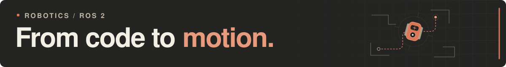
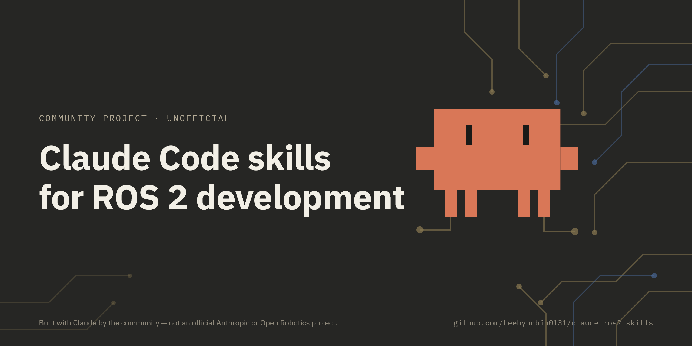

# LEE HYUN BIN

[GitHub](https://github.com/Leehyunbin0131) ·
[Email](mailto:leehyunbin0131@gmail.com)

<h2 align="center">About Me</h2>

  

  

자율주행과 SLAM, 서비스 로봇에 관심이 있습니다.

### Tech Stack

  
  
  

### 학력 · 활동

  <strong>학력</strong> · 대구대학교 컴퓨터소프트웨어전공 재학 
  <strong>교육</strong> · 42경산 4기 
  <strong>리더십</strong> · 전자전기공학부 AIS 동아리 회장

### 수상 이력

| 연도 | 대회 · 분야 | 수상 |
| :---: | :--- | :--- |
| **2021** | **전국기능경기대회** 모바일로보틱스 | 🥉 동메달 |
| **2021** | **대구기능경기대회** 모바일로보틱스 | 🥇 금메달 |
| **2020** | **대구기능경기대회** 모바일로보틱스 | 🥈 은메달 |
| **2019** | **IRC 국제로봇콘테스트** 자율형보행 | 🥉 동상 |

---

## Projects

### claude-ros2-skills

ROS 2 개발 절차와 진단 도구를 담은 AI 코딩 스킬 모음

- **기간:** 2026.07 ~ 진행 중
- **개발:** 개인 프로젝트
- **기술:** Python, ROS 2 Jazzy, Claude Code, Codex
- **현재 상태:** 스킬과 진단 도구 구현, 실제 로봇 적용 예정
- **코드:** [GitHub](https://github.com/Leehyunbin0131/claude-ros2-skills)

프로젝트 자세히 보기

#### 시작 계기

AI를 활용해 ROS 2 코드를 작성하면서, 코드가 오류 없이 실행되어도 로봇이 예상과 다르게
동작하는 경우를 여러 번 겪었습니다. 그때마다 실행 결과를 설명하고 수정을 요청해야 했습니다.
이런 시행착오를 줄이고, 실제 개발에 도움이 되는 스킬을 `SKILL.md` 형식으로 직접 만들어 보고자 프로젝트를 시작했습니다.

#### 문제와 목표

개발 요청만으로는 실제 하드웨어 구성이나 센서 장착 방향을 AI가 알기 어려웠습니다.
개발 전에 로봇의 구성과 설정을 확인하고,
구현 후에는 실제 로봇이 의도대로 동작하는지 점검하도록 돕는 것이 목표입니다.

#### 진행 방식

필요한 점검 항목을 스킬 문서로 정리하고, Python으로 진단 도구를 구현했습니다.
문서와 코드 작성에는 AI 코딩 도구를 사용했으며, 각 도구의 동작을 확인하기 위한 테스트도 작성했습니다.

#### 핵심 구현

테스트가 실제로 실행되었는지 확인하는 도구와 좌표계(TF), 통신 설정(QoS),
센서 데이터를 점검하는 도구를 구현했습니다.
데이터가 부족한 경우에는 ‘판정 불가’로 표시합니다.
검증 기록을 저장하고 파일 변경 여부를 확인하는 기능도 추가했습니다.

#### 결과

현재는 스킬과 진단 도구를 구현한 상태이며, 실제 로봇 개발에는 아직 적용하지 않았습니다.
다음 로봇 프로젝트에 직접 적용해 개발에 도움이 되는지 확인하고,
필요한 부분을 개선할 예정입니다.

<!-- 새로운 프로젝트는 위와 같은 형식으로 아래에 추가합니다. -->
