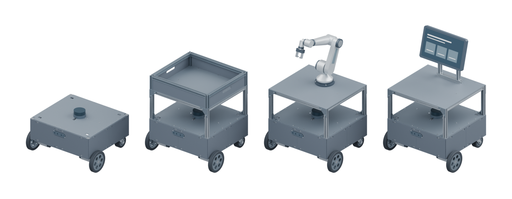
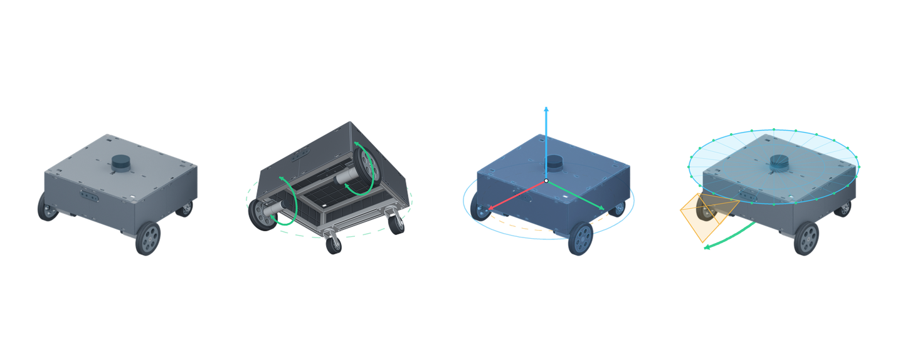
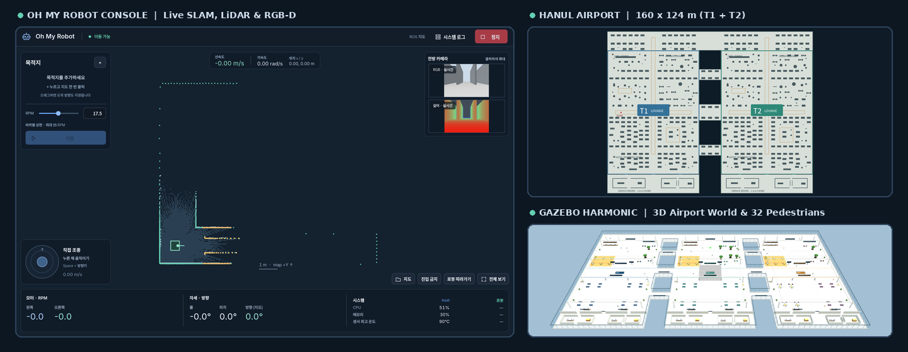
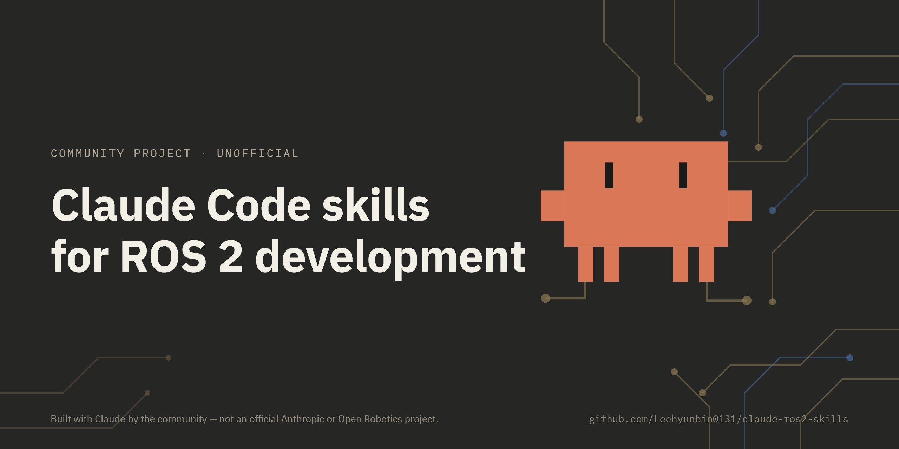

# LEE HYUN BIN

[GitHub](https://github.com/Leehyunbin0131) ·
[Email](mailto:leehyunbin0131@gmail.com)

## About Me

<table>
  <tr>
    <td align="center" valign="top">
      <picture>
        <source media="(max-width: 600px)" srcset="assets/profile.jpg" width="110">
        
      </picture>
    </td>
    <td valign="top">
      
<strong>자율주행 · SLAM · 서비스 로봇</strong>

      

        
        
        
      

      
<strong>학력</strong> 대구대학교 컴퓨터소프트웨어전공 재학

      
<strong>활동</strong> 42경산 4기 전자전기공학부 AIS 동아리 회장

    </td>
  </tr>
</table>

### 수상 이력

<table>
  <thead>
    <tr><th scope="col">연도</th><th scope="col">수상</th><th scope="col">대회 · 분야</th></tr>
  </thead>
  <tbody>
    <tr>
      <td><strong>2021</strong></td><td nowrap>🥉 동메달</td>
      <td><strong>전국기능경기대회</strong> · 모바일로보틱스</td>
    </tr>
    <tr>
      <td><strong>2021</strong></td><td nowrap>🥇 금메달</td>
      <td><strong>대구기능경기대회</strong> · 모바일로보틱스</td>
    </tr>
    <tr>
      <td><strong>2020</strong></td><td nowrap>🥈 은메달</td>
      <td><strong>대구기능경기대회</strong> · 모바일로보틱스</td>
    </tr>
    <tr>
      <td><strong>2019</strong></td><td nowrap>🥉 동상</td>
      <td><strong>IRC 국제로봇콘테스트</strong> · 자율형보행</td>
    </tr>
  </tbody>
</table>

---

## Projects

### Oh-My-MobileRobot

  
  
  
  
  
  

2020 알루미늄 프로파일로 모바일 로봇 베이스를 직접 설계하고 제작한 프로젝트입니다. CAD 원본에서 ROS 1과 ROS 2용 시각화 메시와 URDF/Xacro 모델을 뽑아내고 검증하는 변환 도구까지 함께 만들었습니다.

- **기간:** 2026.10 ~ 2026.11
- **개발:** 개인 프로젝트
- **현재 상태:** 기본 베이스 실물 제작과 주행 확인 완료, 기본 베이스 부품의 STL·1:1 도면과 확장형 3종의 CAD·ROS 모델 공개
- **저장소:** [GitHub](https://github.com/Leehyunbin0131/Oh-My-MobileRobot) ([실물 사진 · 주행 영상](https://github.com/Leehyunbin0131/Oh-My-MobileRobot#completed-robot))

프로젝트 자세히 보기

#### 배경과 목표

베이스 프레임은 하나로 두고 위에 올리는 모듈만 바꿔서 여러 용도로 쓸 수 있는 모바일 로봇을 만들고 싶었습니다.
보통 기구 설계와 ROS 모델이 따로 놀다 보면 나중에 센서 위치나 바퀴 치수가 어긋나기 쉽습니다. 그래서 CAD 파일과 3D 프린팅 부품, ROS 좌표계를 처음부터 한곳에서 맞춰 관리하는 데 신경 썼습니다.

#### 설계와 구현

- **기구 설계와 실물 제작:** 2020 알루미늄 프로파일로 440 × 400 × 140 mm 크기 프레임을 짰습니다. 앞쪽에 구동 바퀴 2개, 뒤쪽에 캐스터 2개를 두고 4분할 상판, 측면 커버, 센서 고정부, 2층 전장판을 설계해 기본 베이스를 직접 조립했습니다. 기본 베이스 위에 적재함, 6축 로봇암, 안내 디스플레이를 올리는 3층 확장 모델 3종도 같은 규격으로 만들어 두었습니다.
- **ROS 모델 자동 변환:** 기본 베이스와 확장형 3종이 공통 Xacro와 메시를 쓰도록 정리했습니다. 구동 바퀴와 캐스터 관절, 라이다와 카메라 좌표계, ROS 1과 ROS 2용 RViz 실행 설정을 넣었습니다. CAD 원본에서 시각화 메시와 URDF를 자동으로 뽑아 주는 Python 스크립트도 작성했습니다.

#### 검증과 결과

CAD 파일 해시가 맞는지, 메시나 링크 트리에 빠진 부분이 없는지, 바퀴 접지 높이와 센서 축 방향이 정확한지 확인하는 단위 테스트를 만들어 모델 정합성을 점검했습니다.
기구 설계 원본부터 출력용 STL, 1:1 도면, ROS 모델과 한·영 문서까지 한 저장소에 정리해 공개했습니다. 제어기나 동역학 시뮬레이션 설정은 이후 단계에서 그대로 추가할 수 있게 열어 두었습니다.

---

### Oh-My-Control

  
  
  
  

`Oh-My-MobileRobot`으로 만든 하드웨어에 1 kHz 모터 제어 펌웨어를 올리고 구동 보정과 IMU 캘리브레이션, 터미널 진단 도구를 만든 프로젝트입니다.

- **기간:** 2026.10 ~ 2026.11
- **개발:** 개인 프로젝트
- **현재 상태:** Mega 1 kHz 속도 PID와 정지 위치 유지 펌웨어, 구동 보정과 IMU 보정 도구, 터미널 진단 대시보드 구현과 실기 검증 완료
- **저장소:** [GitHub](https://github.com/Leehyunbin0131/Oh-My-Control) ([실물 사진 · 주행 영상](https://github.com/Leehyunbin0131/Oh-My-Control#driving-demo))

프로젝트 자세히 보기

#### 배경과 목표

로봇에 바로 ROS 2 자율주행 스택을 올리기 전에, 모터와 엔코더, IMU, 라이다, 깊이 카메라가 명령대로 정확히 움직이는지부터 바닥에서 검증할 필요가 있었습니다.
상위 스택 없이도 하드웨어만 단독으로 띄워서 속도를 제어하고 센서 상태나 바퀴 방향을 바로 점검하고 보정할 수 있는 제어 계층을 만드는 것이 목표였습니다.

#### 설계와 구현

- **1 kHz 모터 제어 펌웨어와 `OMR1` 프로토콜:** Arduino Mega 2560의 Timer1 인터럽트로 1 kHz 제어 루프를 돌리고 구적 엔코더는 20 kHz로 읽도록 짰습니다. 속도 PID 제어기는 바퀴별, 방향별로 따로 두었습니다. 정지했을 때는 그 자리에 버티는 `HOLD` 제어가 들어가게 했습니다. 시리얼 통신에는 CRC16과 시퀀스 번호, 300 ms 명령 유효기간, 과속과 출력 포화, 엔코더 오류 감시를 넣어 통신이 끊겨 유효기간이 만료되거나 이상이 생기면 모터 출력을 차단하도록 했습니다.
- **구동 보정과 PID 오토튠, 자이로 영점 보정:** 좌우 바퀴 채널과 전진 부호, 엔코더 부호를 판별하는 도구와 계단 응답을 보고 피드포워드와 PID 계수를 자동으로 찾는 오토튠 도구를 만들었습니다. 외장 IMU인 HFI-A9과 RealSense D435i 내장 IMU의 정지 자이로 바이어스를 재고 검증하는 스크립트도 함께 작성했습니다.
- **SSH 터미널 진단 대시보드:** 로봇에 모니터를 달기 어려운 환경이라 SSH 터미널만으로 로봇 상태를 볼 수 있게 만들었습니다. 3D 와이어프레임 자세, 카메라 컬러와 깊이 문자 영상, 라이다 포인트 분포, 엔코더와 모터 상태를 한 화면에서 보면서 키보드로 바로 주행 테스트를 할 수 있습니다.

#### 검증과 결과

실제 C++ 펌웨어 코어에 가상 모터와 시리얼 모델을 붙여 단위 테스트와 통합 테스트를 돌렸습니다. 상태 전환, 명령 유효기간 만료, CRC 오류 복구, 보정 계산이 의도대로 동작하는지 코드 수준에서 먼저 확인했습니다.
실물 보정으로 얻은 바퀴 방향, PID 계수, IMU 영점 값은 `config/*.json` 파일로 저장해 상위 ROS 2 자율주행 스택에서 그대로 불러다 쓸 수 있게 했습니다.

---

### Oh-My-SLAM

  
  
  
  
  
  
  

`Oh-My-MobileRobot` 모델과 `Oh-My-Control` 1 kHz 모터 제어 계층 위에 올린 자율주행 워크스페이스입니다. ROS 2 구동 브리지, EKF, 2D SLAM과 AMCL, `Nav2` 자율주행, Gazebo 공항 시뮬레이션, PySide6 제어 콘솔까지 한곳에 묶었습니다.

- **기간:** 2026.11
- **개발:** 개인 프로젝트
- **현재 상태:** ROS 2 구동 브리지, EKF, Gazebo 2터미널 공항 환경, 2D SLAM/AMCL, State Lattice + DWB 자율주행, Qt 통합 콘솔 구현과 시뮬레이션 검증 완료, Jetson Orin 실기 배치 예정
- **저장소:** [GitHub](https://github.com/Leehyunbin0131/Oh-My-SLAM) ([아키텍처](https://github.com/Leehyunbin0131/Oh-My-SLAM/blob/main/docs/architecture.md) · [자율주행](https://github.com/Leehyunbin0131/Oh-My-SLAM/blob/main/docs/sim_navigation.md) · [로봇 콘솔](https://github.com/Leehyunbin0131/Oh-My-SLAM/blob/main/docs/operator_gui.md))

프로젝트 자세히 보기

#### 배경과 목표

앞선 두 프로젝트에서 하드웨어와 저수준 모터 제어까지 마무리했으니 이제 그 위에 실제 자율주행 스택을 올릴 차례였습니다. 시뮬레이션에서 굴린 코드를 실물 로봇에 옮길 때 설정을 갈아엎지 않도록, Gazebo Harmonic과 Jetson Orin 실물 로봇이 같은 ROS 2 토픽과 TF, 명령 유효기간 규칙을 쓰게 설계했습니다.
주행만 되는 수준으로 끝내지 않고 300 ms 명령 유효기간, TF 단독 발행 규칙, 실측 기반 오도메트리, 라이다 아래쪽 낮은 장애물 처리, 운영자 콘솔까지 한 흐름으로 묶는 데 초점을 맞췄습니다.

#### 설계와 구현

- **Sim-to-Real 구동 브리지와 EKF 상태 추정:** `LifecycleNode`로 만든 `omslam_base`가 `TwistStamped`의 최초 생성 시각을 그대로 유지하면서 300 ms 명령 유효기간을 검사합니다. 바퀴별 상한은 시뮬레이션 3–70 RPM, 실물 3–95 RPM으로 제한했습니다. 3.0 RPM 미만인 작은 명령은 억지로 끌어올리지 않고 0으로 끊었습니다. 오도메트리는 목표 속도를 적분하는 대신 실제 엔코더 변화량을 SE(2)로 적분해 발행합니다. `robot_localization` 2D EKF는 이 바퀴 오도메트리의 속도(`vx`, `wz`)와 장착 TF로 회전시킨 IMU 각속도를 결합해 `odom → base_footprint`를 단독으로 발행합니다.
- **Gazebo 공항 환경과 2D SLAM·AMCL:** 좌석과 카페, 연결 통로, 걷는 보행자 32명이 있는 160 × 124 m 크기 2터미널 가상 공항을 만들고 CAD 모델에 가상 라이다, IMU, RGB-D 센서를 붙였습니다. 지도 작성과 위치추정은 `slam_toolbox`와 `AMCL`이 동시에 켜지지 않도록 모드를 나눴습니다. 지도 이미지와 포즈 그래프는 함께 저장하고 복원할 수 있게 했습니다.
- **Nav2 자율주행과 RGB-D 낮은 장애물 기억:** 전역 계획에는 공식 ROS 2 Jazzy의 `SmacPlannerLattice`를 쓰고 지역 제어에는 속도 인식 궤적 생성과 차체 외곽 충돌 검사, 회전 방향과 진동 평가를 넣은 커스텀 `DWB` 플러그인을 붙였습니다. 라이다보다 낮은 장애물은 2D 스캔에 걸리지 않습니다. 그래서 깊이 카메라로 바닥 위 장애물을 따로 걸러내 시야에서 벗어나도 잠시 기억해 두는 비용지도 레이어를 추가했습니다. `navigation_guard`는 센서와 TF, 명령 신선도, 갑작스러운 `map → odom` 보정을 지켜보다가 이상이 생기면 바로 구동을 차단합니다.
- **지도 중심 제어 콘솔 `Oh My Robot Console`:** PySide6와 Qt Quick으로 데스크톱 앱을 만들었습니다. 지도 위에서 목적지를 하나 또는 여러 개 찍어 이동시키고 직접 조종과 바퀴별 RPM 상한 조절, 진입 금지 구역 편집과 저장, 실시간 카메라 영상과 구동 계측, 시스템 로그 확인까지 한 화면에서 처리합니다.

#### 검증과 결과

단위 테스트와 회귀 테스트, 설치본 DWB 프로브, 격리된 ROS 도메인의 헤드리스 Gazebo 통합 검증을 작성했습니다. 기구학 계산, 명령 유효기간 만료, 지연 정지, 충돌 경계, 5 cm 도착 판정, 지도 번들 저장과 복원, 콘솔 제어권 전환까지 자동으로 확인합니다.
시뮬레이션에서 목표 5개를 연속으로 자율주행해 충돌 0회로 도착, 정지, 오차 기준을 모두 통과했습니다. 시뮬레이션 계층 검증을 마쳤으며, 장비별 시리얼 설정과 실물 보정·검증을 거쳐 Jetson Orin에 배치할 예정입니다.

---

### claude-ros2-skills

  
  
  
  

AI 코딩 도구를 위한 스킬과 진단 도구입니다. ROS 2 로봇 코드를 작성할 때 하드웨어 구성과 센서 방향을 먼저 확인하고 실행 뒤에는 TF와 QoS, 센서 데이터, 테스트 실행 여부까지 점검하게 합니다.

- **기간:** 2026.07 ~ 진행 중
- **개발:** 개인 프로젝트
- **현재 상태:** 스킬 문서(`SKILL.md`)와 Python 진단·검증 도구 구현 완료, 실제 로봇 적용 예정
- **저장소:** [GitHub](https://github.com/Leehyunbin0131/claude-ros2-skills)

프로젝트 자세히 보기

#### 배경과 목표

AI 코딩 도구로 ROS 2 코드를 짜다 보면 문법 오류 없이 잘 실행되는데도 실제 로봇에서는 엉뚱하게 움직이는 일이 자주 있었습니다. 대부분 하드웨어 배선이나 센서 장착 방향, 토픽 설정을 확인하지 않고 넘어가서 생기는 문제였습니다.
코드를 쓰기 전에 로봇 구성부터 확인하고 수정이 끝나면 실제 동작과 데이터를 따져 보는 절차를 잡아 두어 불필요한 반복 수정을 줄이고 싶었습니다.

#### 설계와 구현

- **점검 절차 스킬화:** 개발 전후에 꼭 확인해야 할 항목을 정리해 AI 에이전트가 읽고 따를 수 있는 `SKILL.md` 문서로 구성했습니다.
- **ROS 2 진단과 기록 도구:** 좌표계 연결, QoS 호환성, 센서 데이터를 확인하는 Python 도구를 만들었습니다. 테스트가 실제로 돌았는지와 파일 변경 내역, 검증 기록도 같이 남깁니다. 데이터가 부족해 판단하기 어려울 때는 억지로 통과시키지 않고 ‘판정 불가’로 남겨 두도록 했습니다.

#### 검증과 결과

각 진단 도구가 의도대로 동작하는지 단위 테스트를 작성해 확인했습니다.
지금은 스킬 문서와 진단 도구 구현을 마쳤고 실제 로봇 프로젝트에 붙여 얼마나 도움이 되는지 확인하면서 다듬어 나갈 예정입니다.

<!-- 새로운 프로젝트는 위와 같은 형식으로 아래에 추가합니다. -->
